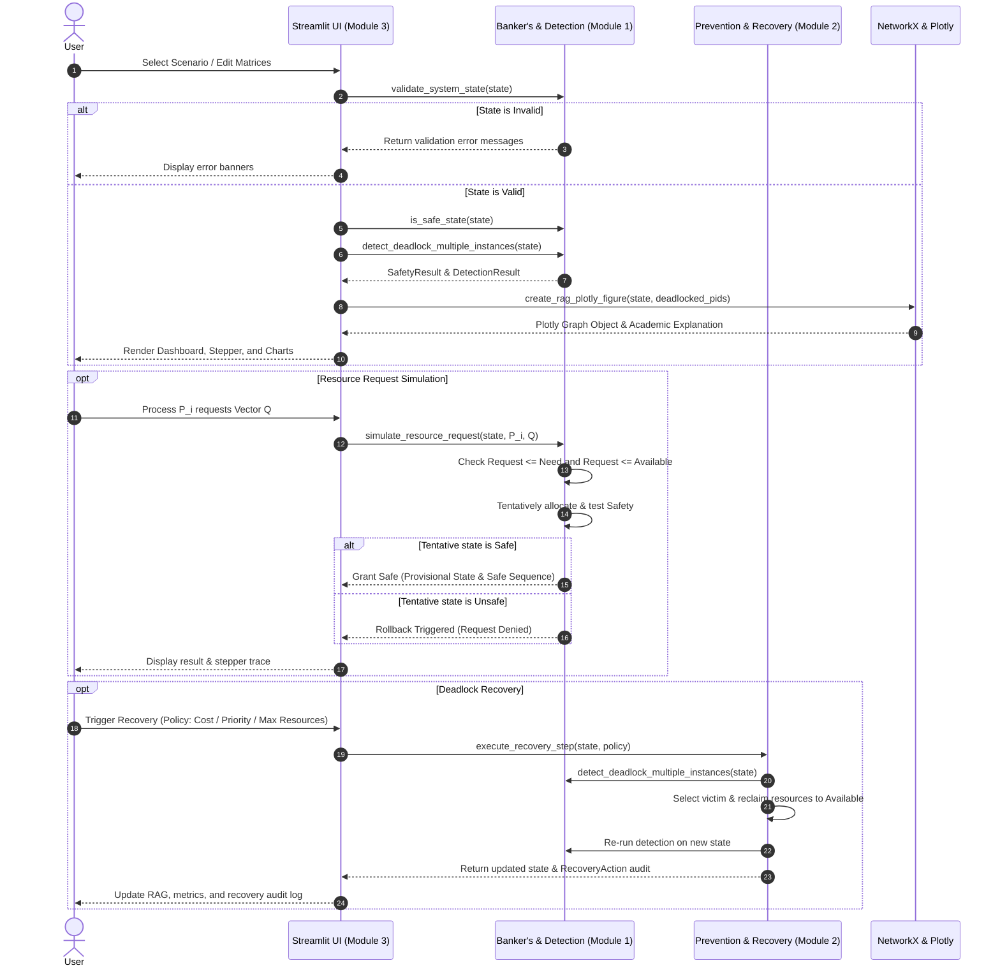

# Technical Architecture: Deadlock Prevention and Recovery Toolkit

**Course:** CSE316 Operating Systems  
**Institution:** Lovely Professional University (LPU)  
**Project:** Deadlock Prevention and Recovery Toolkit  

---

## 1. System Overview

The Deadlock Prevention and Recovery Toolkit is an interactive, educational laboratory simulator built to model and analyze operating system resource allocation states, deadlock avoidance, detection, prevention, and recovery. The toolkit runs purely on an in-memory mathematical model, guaranteeing that no actual host operating-system processes or kernel allocations are ever modified or terminated.

The toolkit is strictly organized into **three decoupled, highly cohesive modules**:
1. **Module 1: Deadlock Analysis Engine** (`core/bankers.py`, `core/detection.py`, `core/models.py`, `core/validation.py`)
2. **Module 2: Prevention and Recovery Engine** (`core/prevention.py`, `core/recovery.py`, `core/scenarios.py`)
3. **Module 3: Interactive Simulation and Visualization** (`ui/`, `visualization/`, `app.py`)

---

## 2. Module Breakdown

### Module 1: Deadlock Analysis Engine
The analysis engine encapsulates the theoretical algorithms for state safety evaluation and deadlock detection. It is completely independent of Streamlit and graph visualization libraries.

* **Core Data Model (`core/models.py`)**:
  * `SystemState`: Encapsulates vectors $E$ (Total capacity), $A$ (Available), and matrices $C$ (Allocation), $M$ (Maximum claim), $N$ (Need), $Q$ (Outstanding request), alongside priorities, restart costs, and termination flags.
  * `StepTrace`: Captures step-by-step progress ($W$, process $P_i$, requirement vector, evaluation result, and updated $W$).
  * `SafetyResult` & `DetectionResult`: Structured outputs reporting safety status, safe sequences, unresolved processes, and cycles.
* **Validation Engine (`core/validation.py`)**:
  * Enforces dimensional alignment ($n$ processes, $m$ resources).
  * Validates non-negativity across all vectors and matrices.
  * Validates claim integrity: $\text{Allocation}[i][j] \le \text{Max}[i][j]$.
  * Enforces the Conservation Law of Resources: $\text{Total}[j] = \text{Available}[j] + \sum_{i=1}^n \text{Allocation}[i][j]$.
  * Validates incoming resource requests against remaining need ($\text{Request}_i \le \text{Need}_i$) and available units ($\text{Request}_i \le \text{Available}$).
* **Banker's Avoidance Algorithm (`core/bankers.py`)**:
  * Implements Dijkstra's Banker's Algorithm with $O(m \cdot n^2)$ time complexity.
  * Calculates Need Matrix $N = M - C$.
  * Searches for safe execution sequences via backtracking (`find_all_safe_sequences`).
  * Tentatively simulates requests with immediate rollback if the grant leads to an unsafe state.
* **Deadlock Detection (`core/detection.py`)**:
  * Implements the multi-instance deadlock detection algorithm based on actual outstanding requests $Q$.
  * Implements Tarjan's cycle detection on the Resource Allocation Graph (RAG) using NetworkX.
  * Distinguishes between single-instance systems (where a cycle is necessary and sufficient) and multiple-instance systems (where a cycle is necessary but not sufficient).

---

### Module 2: Prevention and Recovery Engine
Focuses on static constraints that eliminate Coffman's conditions, and active recovery mechanisms to restore system progress.

* **Deadlock Prevention Protocols (`core/prevention.py`)**:
  * **Havender's Scheme (Circular Wait Prevention):** Imposes a total ordering function $F: R \to \mathbb{N}$ on all resource types. Verifies that a process requesting $R_j$ holds only resources $R_i$ with $F(R_j) > F(R_i)$.
  * **Hold-and-Wait Protocol A (Conservative Pre-allocation):** Requires all resources to be allocated in an initial batch before execution begins.
  * **Hold-and-Wait Protocol B (Release-Before-Request):** Requires a process holding any resources to release all of them before requesting new ones.
  * **Trade-Off Matrix:** Formal documentation of resource utilization, runtime overhead, and starvation risks across strategies.
* **Deadlock Recovery Engine (`core/recovery.py`)**:
  * Supports four victim selection policies:
    1. `LOWEST_PRIORITY`: Terminates the process with lowest priority rating.
    2. `LOWEST_COST`: Terminates the process minimizing computational/restart cost.
    3. `MAX_RESOURCES`: Heuristic selecting the process holding the largest sum of allocated resource units to maximize reclaimed capacity.
    4. `MANUAL`: Explicit user-directed victim selection.
  * Safe resource reclamation: $\text{Available} \leftarrow \text{Available} + \text{Allocation}[\text{victim}]$, setting allocations and requests to zero, and marking the process as `TERMINATED`.
  * Multi-step recovery loop: Iteratively terminates victims and re-runs detection until the system is completely free of deadlocks.
* **Predefined Presets (`core/scenarios.py`)**:
  * 5 verified presets: Safe System, Unsafe Not Deadlocked, Single-Instance Deadlock, Multi-Instance Cycle Without Deadlock, and Recoverable Deadlock.

---

### Module 3: Interactive Simulation and Visualization
Provides a web-based, classroom-ready user interface built with Streamlit, Plotly, and NetworkX.

* **Interactive RAG (`visualization/resource_graph.py`)**:
  * NetworkX directed bipartite graph.
  * Process nodes rendered as circles (green: safe, red: deadlocked, gray: terminated).
  * Resource nodes rendered as purple squares with total/available badge indicators.
  * Allocation edges ($R_j \to P_i$) rendered as blue directed arrows.
  * Request edges ($P_i \to R_j$) rendered as amber directed arrows.
  * Cycle highlighting: Directed cycle edges dynamically highlighted in bright red.
* **Analytics and Charts (`visualization/charts.py`)**:
  * Stacked bar chart showing Allocated vs Available capacity per resource type.
  * Recovery audit chart displaying cost and reclaimed units per victim.
  * Algorithmic benchmark curves showing scaling time (ms) over process counts ($n=5$ to $100$).
* **UI Views (`ui/`)**:
  * `dashboard.py`: Executive summary metric cards and live RAG snapshot.
  * `scenario_builder.py`: Interactive matrix editor, automatic Need computation, and JSON/CSV export/import.
  * `analysis_page.py`: Banker's safety evaluation, interactive step-by-step stepper, request simulator with rollback, and detection traces.
  * `prevention_page.py`: Interactive rule testers for Havender's ordering and Hold-and-Wait protocols.
  * `recovery_page.py`: Recovery workbench, policy selection, manual termination, and recovery audit log.
  * `what_if_page.py`: Side-by-side comparative analyzer for parameter perturbations.
  * `benchmark_page.py`: Performance benchmarking with academic disclaimer.

---

## 3. Data Flow Diagram

